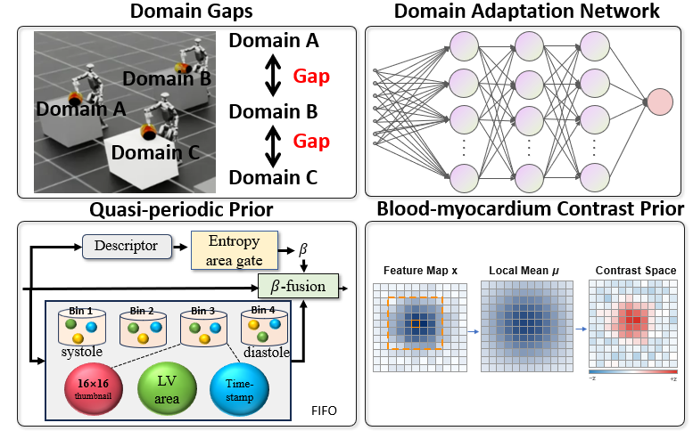
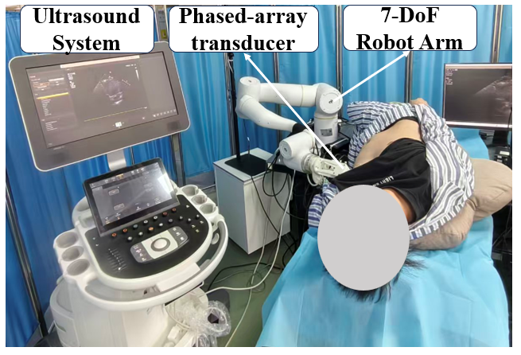

# Cardiac Prior-Guided Unsupervised Domain Adaptation for Video Segmentation in Robotic Echocardiography

*Thank you very much for reviewing our paper!*

## Abstract

<p align="center">
  
</p>

## Robot Setting

<p align="center">
  
</p>

## Setup

```bash
conda create -n echomap python=3.12 -y && conda activate echomap
pip install -r requirements.txt
```

Sanity check (no data/checkpoints needed, CPU or GPU):

```bash
python smoke_test.py   # config compose + backbone forward + CFMC + all UDA losses
```

## Data preparation

1. **CAMUS (source)** — download the official NIfTI release, then:

   ```bash
   python tools/prepare_camus.py --src <CAMUS_nifti_root> --dst ./data/camus_png256x256
   ```

2. **EchoNet-Dynamic (target)** — download the official dataset, then:

   ```bash
   python tools/prepare_echonet.py --src <EchoNet_root> --dst ./data/echonet_png256x256
   ```

Both loaders expect the `camus_public_datasplit_20250706.json` split file
(produced by the prepare scripts; train/val/test are video- and patient-disjoint).

## Training

```bash
# staged pipeline (recommended; pass the previous stage's checkpoint via
# main_training.init_weights when starting stage 2 / 3):
python train.py --config-name=echonet_cfmc
python train.py --config-name=echonet_cfmc_ptc \
    main_training.init_weights=<stage1_ckpt>.pth
python train.py --config-name=echonet_cfmc_ptc_cdpa \
    main_training.init_weights=<stage2_ckpt>.pth

# or, all components in one run (still needs a source-only init):
python train.py --config-name=echonet_full \
    main_training.init_weights=<source_only_ckpt>.pth
```

## Evaluation

CAMUS test split (per-frame Dice / IOU):

```bash
python evaluate.py --data ./data/camus_png256x256 --split test_data \
    --weights <ckpt> --out ./outputs/eval_camus
```

EchoNet-Dynamic target (full-sequence carry-state inference):

```bash
python infer.py --weights <ckpt> --data ./data/echonet_png256x256 \
    --split test --carry-state --out ./outputs/eval_echonet
```

Regression tests (CFMC teacher alignment, target GT hiding, UDA losses):

```bash
python scripts/test_uda_stage1.py teacher_align
python scripts/test_uda_stage1.py hide_gt
python scripts/test_uda_stage1.py uda_loss
```

## License

Apache-2.0 (see `LICENSE`); the backbone modules retain their original license
and attribution (see `NOTICE`).

## Acknowledgements

We reference a lot from https://wangrui2025.github.io/GDKVM/en/.
